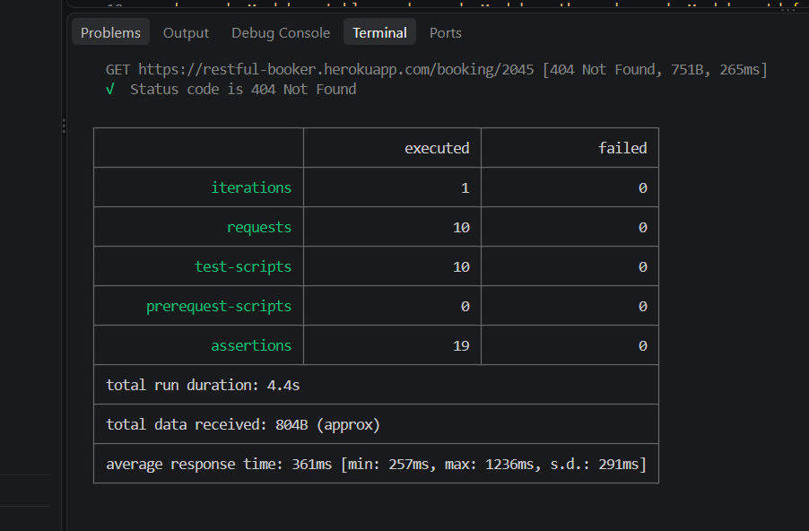

# Postman API Testing

Automated API tests for the Restful Booker hotel booking API using Postman, Newman and GitHub Actions.

## What is tested
**10 requests, 19 assertions**

| # | Request | Expected |
|---|---------|----------|
| 1 | Health check | 201 |
| 2 | Create auth token (saved to environment) | 200 + token |
| 3 | Create token with wrong password | Bad credentials, no token |
| 4 | Create booking (ID saved to environment) | 200 + booking ID |
| 5 | Get booking | 200 + correct details |
| 6 | Update booking with token | 200 + updated price |
| 7 | Update booking without token | 403 Forbidden |
| 8 | Partial update (PATCH) | 200, only one field changed |
| 9 | Delete booking | 201 |
| 10 | Get deleted booking | 404 Not Found |

## Techniques used
- Request chaining: token and booking ID are saved with `pm.environment.set()` and reused
- Positive and negative testing (403, 404, invalid credentials)
- Status code, response body and response time assertions
- Environment variables for the base URL, token and booking ID

## Observations
- A wrong password returns **200 OK** with "Bad credentials" instead of **401 Unauthorized**.
- A successful delete returns **201 Created** instead of the usual **200** or **204**.
- Updating a booking that no longer exists returns **405** instead of **404**.

## Tools used
- Postman (collections, environments, JavaScript test scripts)
- Newman CLI with HTML reports
- GitHub Actions (tests run automatically on every push)

## How to run
1. Install Node.js
2. Run `npm install -g newman newman-reporter-htmlextra`
3. Run `newman run restful-booker.postman_collection.json -e restful-booker.postman_environment.json -r cli,htmlextra`

Or import both `.json` files into Postman and run the collection.

## Test report
